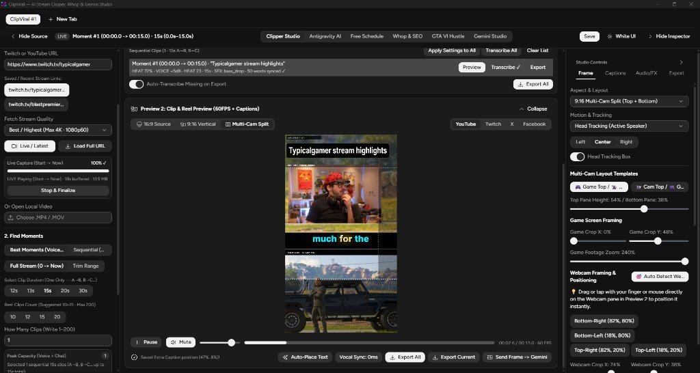

# ViralClip by Aivory

**AI Stream Clipper, Auto-Caption Studio & YouTube Shorts Scheduler for Windows (64-bit).**

Turn Twitch, YouTube, and local gameplay or podcast videos into vertical 9:16 Shorts, Reels, and TikToks with split-screen facecam framing, word-synced active captions, AI tools, and one-tap YouTube auto-scheduling.

---

## Download (64-Bit Aivory Setup Wizard)

Download the compressed 64-bit Windows installer from the [**Latest Release**](https://github.com/pushpajit-dev/ViralClip/releases/latest):

- **`ViralClip-Setup-v1.4.0-x64.exe`** — Official Aivory 64-bit Setup Wizard (LZMA2 solid compressed)

> **No manual Python or Node.js setup required.** The 64-bit installer includes all compiled Python runtime libraries, FFmpeg media tools, and GPU upscaling binaries — without bloating the installer with bulky AI models.

---

## Installation & First-Time Setup

1. **Run `ViralClip-Setup-v1.4.0-x64.exe`** — Follow the Aivory 64-bit Setup Wizard to install ViralClip and all required libraries automatically.
2. **Download Required Models (First Launch)** — When you open ViralClip for the first time, the built-in **First-Time Model Setup** screen downloads the required Faster-Whisper speech model with a live progress bar and percentage (`0% -> 100%`) and auto-detects Antigravity AI (or local Ollama).
3. **Activate Your License** — Once model setup completes, enter your **Email** and **License Code** and click **Activate** to unlock ViralClip Studio.

---

## Purchase & Activation

- **Buy on Gumroad:** [Purchase ViralClip on Gumroad](https://pushpajit.gumroad.com/l/zabnjf)
- **Aivory Portal & 1-Month Trial Keys:** [Open Aivory Portal](https://aivoryproducts.netlify.app)

### How Activation Works
- **Gumroad Buyers:** Enter the exact email used during Gumroad checkout and your Gumroad license key, then click **Activate**.
- **Aivory Portal / Trial Users:** Enter your registered email and the license or 1-month trial code issued on Aivory Portal, then click **Activate**.
- **Device Policy:** Each license locks strictly to **1 Windows PC** and requires an active internet connection on startup.

---

## Highlights

- **Live & Local Stream Ingest** — Capture directly from Twitch / YouTube URLs or import local `.mp4` / `.mov` files.
- **9:16 Multi-Cam Split & Auto-Framing** — Separate gameplay and webcam panes with drag-to-position sliders, head tracking, and layout presets.
- **Word-Synced Active Captions** — Accurate per-clip timecode transcription with live active-word highlight color, font scale, opacity, and free X/Y positioning.
- **AI Studio Tools** — Auto-connects to Antigravity when detected, or falls back smoothly to local Ollama + Faster-Whisper.
- **One-Tap YouTube Auto-Scheduler** — Automatically selects thumbnails, generates topic-relevant tags, and schedules uploads with live progress tracking.
- **Interactive First-Time Walkthrough** — Guided step-by-step spotlight tooltips on first launch.

---

## System Requirements

- **OS:** Windows 10 / Windows 11 (64-bit)
- **RAM:** 8 GB minimum (16 GB recommended)
- **Storage:** ~1.5 GB free space (including downloaded speech models)
- **Network:** Active internet connection required for first-run model download, license activation, and streaming/YouTube features

---

*This repository distributes official compiled Aivory ViralClip releases only. Source code is proprietary.*
